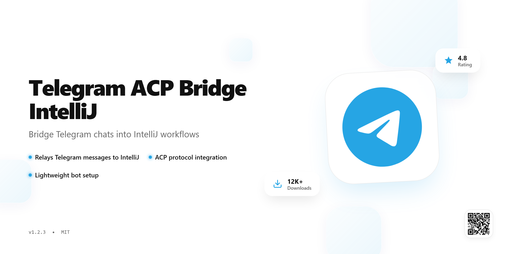

# 🚀 Community-Rich Agent Tasks & Chat Controls for Telegram & Discord

### ⌨️ PowerShell Command Button

   

---

Telegram ACP Bridge IntelliJ is a community project that lets you steer coding sessions and chat with your agent without leaving Telegram, turning quick requests into real work inside IntelliJ. Run tasks, juggle multiple chats, and keep an eye on pending approvals through a friendly bot interface that stays out of your way. Features keep growing thanks to contributors who suggest tweaks and build out new capabilities, so every workflow gets a little smoother. It pairs neatly with your existing setup, giving you an open and approachable companion for day-to-day agent tasks. Whether you're sketching or shipping changes, the bridge keeps you connected to your agent from wherever you are.

## ✅ Before You Start

- Windows 10 or Windows 11
- PowerShell 5.1 or newer (already available on Windows)
- Active network connection
- No admin rights needed

## Features

**📱 Chat-driven workflow** — fire off tasks, check progress, and steer your IntelliJ agent without ever leaving Telegram. The bot window mirrors everything, so you can work from whichever surface feels right.

- **🧵 Session management on the fly** — spin up fresh chats, list what's open, and switch between them with quick commands. Your project stays open; the bridge handles the rest.

- **📋 Task queue that waits its turn** — stack up requests, peek at what's pending, clear the slate, or resume where you left off. No more shouting into the void while the agent is busy.

- **⚙️ Model and reasoning controls** — pick the model and effort level your agent offers, right from the chat. Tune the brain to match the job.

- **✅ Approvals without the app-switching** — review pending confirmations and agent questions from your phone. First connections and permissions still get confirmed in IntelliJ, keeping you in the loop.

- **🗒️ Notes, snapshots, and context care** — jot quick notes, grab a screenshot, compact the context, and keep an eye on limits. Small tools that add up to smoother long sessions.

- **😴 Scheduled hibernation** — tell the bot when to tuck Windows in for the night, schedule it after a time, or cancel it entirely. Wake timers do the rest.

- **🔒 Owner-only, private-chat first** — only the paired owner can send commands or answer approvals, and everything happens in a private chat. Local secrets stay local — keep token files and personal configs out of public view.

- **🧩 Extensible by design** — the source is yours to shape. Ask the agent to add a command, wire up a menu button, and update the docs — then review the diff in IntelliJ and restart. Whether it lands in Telegram, the bot window, or both is up to you.

- **🛠️ Built for tinkerers and teams alike** — a friendly setup wizard, a menu that lists every action, and a community that trades freely. Bring your workflow, and the bridge bends to meet it.

## Quick Start

Getting up and running is refreshingly straightforward: the bridge runs as a lightweight local companion that hands your Telegram messages to the ACP agent inside IntelliJ. There is nothing exotic to install beyond the prerequisites — a current Windows environment with Python 3.11+ including Tkinter, an IntelliJ installation with JetBrains AI Assistant present and enabled, a configured ACP agent, and a Telegram bot token you control. No third-party Python packages are pulled in, so the whole thing stays self-contained and easy to audit.

The first-run flow walks you through pairing step by step:

- **Configure locally.** Launch the setup helper from the project root and follow its prompts. It creates your local configuration and pairs the bot, so the boring wiring is handled for you.
- **Register the agent entry.** Take the generated local entry file and merge its contents into the `agent_servers` block of your JetBrains ACP configuration, keeping your existing records untouched. This is what lets IntelliJ know the bridge exists.
- **Add the helper plugin.** Install the bundled helper archive from the project's helper build folder using **Settings → Plugins → ⚙ → Install Plugin from Disk**, then restart the IDE. The helper is what allows chats to be created on demand.
- **Start the bridge.** Run the bundled start script, leave your project open, and hit **New chat** either in Telegram or in the bot window. Approve the incoming connection inside IntelliJ, then simply send your first task.

A couple of friendly notes from the community: you do not need to open an AI chat ahead of time — the helper plugin creates it for you when you ask. The integration was validated against a specific build and leans on an internal AI Assistant API, so newer or older IDE builds may behave differently; if something looks off after an IDE update, that is usually the first place to look.

Once you are paired, everything is driven by chat commands. Use the session commands to create, list, and switch between IntelliJ chats; send plain text (or the ask command) to hand a task to the agent, and the cancel command to stop one mid-flight. A task queue lets you stack work and clear or resume it whenever you like. Model and reasoning-effort selectors appear when your agent offers them, and a pending view surfaces approvals and clarifying questions so nothing gets stuck silently. There are also conveniences for notes, screenshots, context compaction, and usage limits, plus scheduling commands for Windows hibernation when you want the machine to wind down after hours. A menu command reveals the full action list.

Two small habits keep things smooth: confirm the very first connection and any permission prompts inside IntelliJ, and if a chat does not show up within a couple of minutes, check your session list before retrying — requests are not resent automatically. The stop button halts the process and can interrupt an in-progress task, while merely closing an AI chat leaves the bridge running. Sleep-related commands depend on hibernation and wake timers being enabled in Windows, with the bot window kept alive.

And because this project grows through its community: if a command or button you wish existed is missing, just ask the agent to build it. Describe the feature, say whether it belongs in Telegram, the bot window, or both, review the diff in IntelliJ, and restart the bridge after the code changes. That is genuinely how most of the nicer touches here came to be — so jump in, try things, and shape the bridge into the tool you want it to be.

## Commands

Jump right in — the command set is designed to feel like a natural extension of your chat, not a wall of syntax. Whether you're firing off a quick task or orchestrating a whole workflow, there's a command ready for it.

**🗂 Chat & Session Management**
- `/new` — spin up a fresh IntelliJ chat when you want a clean slate
- `/sessions` — browse every open chat at a glance
- `/use ID` — jump straight into a specific chat by its identifier

**✍️ Sending Tasks**
- Just type your message — no prefix needed
- `/ask TEXT` — explicit way to fire off a task
- `/cancel` — pull the plug on whatever's running

**📋 Queue Control**
- `/queue TEXT` — line up a task for later
- `/queue` — peek at what's waiting
- `/clearqueue` — wipe the backlog clean
- `/resumequeue` — pick up where the queue left off

**🧠 Model & Reasoning**
- `/models` — see what the agent has on offer
- `/efforts` — dial the reasoning level up or down when supported

**🔔 Approvals & Questions**
- `/pending` — review anything waiting on your confirmation or input

**📝 Notes, Snapshots & Context**
- `/notes` — list your saved notes
- `/note TEXT` — jot something down on the fly
- `/screenshot` — capture the current view
- `/compact` — compress context to keep things lean
- `/limits` — check your Codex usage boundaries

**😴 Sleep Scheduling**
- `/sleep 08:30` — schedule a hibernation wake-up
- `/sleep_after 08:30` — hibernate once the current work wraps
- `/nosleep` — cancel any pending sleep plan

**🎛 The Menu**
- `/menu` — your one-stop overview of every action available

A quick note on access: commands and approval responses are accepted only from the paired owner in the private chat — keeping your agent sessions in trusted hands. If a command doesn't respond, double-check that you're messaging from the paired account.

This set grows with the community. If there's an action you wish existed, the Customization section below shows how to bring it to life — and sharing your additions back helps everyone.

## Customization & Community

Make the bridge yours. The Telegram ACP Bridge IntelliJ project is built to be extended: commands, menu entries, the bot window, and the Telegram side are all editable in the source, so you can shape the workflow around the way you actually work.

**Extend it by asking.** The fastest way to add something is to ask the agent in this project to build it. For example: "Add a `/foo` command that does X, wire up a menu button, and update the README" — and say clearly whether it belongs in Telegram, the bot window, or both. Review the diff in IntelliJ, then restart the bot to pick up your changes. Small, focused requests tend to land cleanly.

**Tune the experience.** Choose models and reasoning levels on the fly with `/models` and `/efforts` when the agent offers them, manage a task queue with `/queue`, `/clearqueue`, and `/resumequeue`, keep notes with `/notes` and `/note`, and schedule hibernation with `/sleep`, `/sleep_after`, and `/nosleep`. Use `/menu` to discover everything at a glance.

**Contribute back.** Found a rough edge or built a useful addition? Share it with the community — improvements to commands, menu behavior, and documentation are always welcome. Clear descriptions and a diff reviewed in IntelliJ go a long way, and every contribution helps the bridge grow for everyone.

**A friendly note on safety.** Keep `bot-token.txt`, `*.local.json`, `*.local.tmp`, and `notes.local.json` private — they can hold credentials, local settings, and personal notes. Only the paired owner can send commands or respond to approvals in the private chat, so keep that pairing in trusted hands.

## Troubleshooting & FAQ

### Troubleshooting & FAQ

**The bot starts, but no chat shows up in Telegram.**
First connections and agent permissions get confirmed inside IntelliJ — check there for a pending prompt. If two minutes pass with nothing, run `/sessions` instead of sending the same task again: requests are not retried automatically, so a fresh look beats a blind repeat.

**My command got ignored.**
Commands and approvals are accepted only from the paired owner in the private chat. If you're writing from another account or a group, the bridge politely stays silent. Re-pair with the setup wizard if you've switched devices.

**The task stopped mid-flight.**
The **Finish bot** button shuts down the whole process and can interrupt whatever is running. Closing the AI chat window is gentler — the bot keeps going, and you can pick the thread back up with `/sessions`.

**Scheduled sleep didn't trigger.**
Sleep commands rely on Windows hibernation and wake timers being enabled, and the bot window has to stay open. Double-check both, then re-issue `/sleep` or `/sleep_after`.

**A model or effort level is missing.**
`/models` and `/efforts` only list what the agent currently offers, so availability shifts with the agent's configuration. Open `/menu` for the full action list if something you remember isn't showing in the quick commands.

**Can I extend the bridge to fit my workflow?**
Absolutely — that's the community spirit here. Ask the agent to build the missing piece in this very project: describe the command, where it should live (Telegram, the bot window, or both), and have it update the README. Review the diff in IntelliJ, restart the bot, and you're set. Running the bundled unit tests from the project root is a good sanity check before sharing changes.

**What should I keep private?**
Treat `bot-token.txt`, any `*.local.json` / `*.local.tmp` files, and `notes.local.json` as sensitive — they can hold credentials, local settings, and personal notes. Never post them in issues, chats, or screenshots.

**Does it run anywhere besides Windows?**
The hibernation scheduling is Windows-specific; the Telegram-to-agent bridge itself is where the community has been experimenting. If you get it working elsewhere, a short write-up is very welcome.

**Still stuck?**
Ask in the community channels — bugs, feature wishes, and "is this supposed to happen?" moments are all fair game. Friendly, detailed reports get friendly, detailed answers, and every question helps the next person.

## Support & License

Есть вопрос, идея или просто хочется поблагодарить? Мы всегда рады слышать вас — этот проект живёт благодаря сообществу, которое им пользуется, ломает его и помогает делать лучше.

**Как получить помощь**

- Загляните в раздел «Troubleshooting & FAQ» — там собраны ответы на самые частые вопросы, и, скорее всего, ваш случай уже разобран.
- Если ответа нет, откройте обсуждение и опишите, что произошло: версию IntelliJ, сборку плагина, шаги до появления проблемы и текст ошибки. Чем больше деталей, тем быстрее мы разберёмся вместе.
- Нашли баг? Расскажите о нём — даже короткое сообщение помогает. Предложения по улучшению тоже приветствуются: команды, кнопки меню, интеграции — всё обсуждаемо.

**Участие в развитии**

Проект открыт для идей и вклада. Вы можете:

- предложить новую команду или функцию и обсудить её с сообществом;
- поделиться своим опытом настройки и сценариями использования;
- помочь другим участникам с вопросами — иногда один удачный ответ экономит кому-то целый вечер;
- рассказать о проекте тем, кому он может пригодиться.

Любая обратная связь — от опечатки в документации до продуманного pull request — делает мост удобнее для всех.

**Лицензия**

Проект распространяется по открытой лицензии: вы можете изучать исходный код, адаптировать его под свои задачи и делиться изменениями. Подробности — в файле лицензии в корне репозитория. Пожалуйста, сохраняйте упоминание авторства и не публикуйте личные данные, токены и локальные конфигурации.

**Поддержать проект**

Самый простой способ поддержать разработку — пользоваться ботом, сообщать о проблемах и делиться идеями. Если проект оказался полезен, расскажите о нём коллегам и друзьям — лучшая благодарность для нас это растущее сообщество, которое помогает делать мост между Telegram и IntelliJ всё удобнее.

Спасибо, что вы с нами. 💙